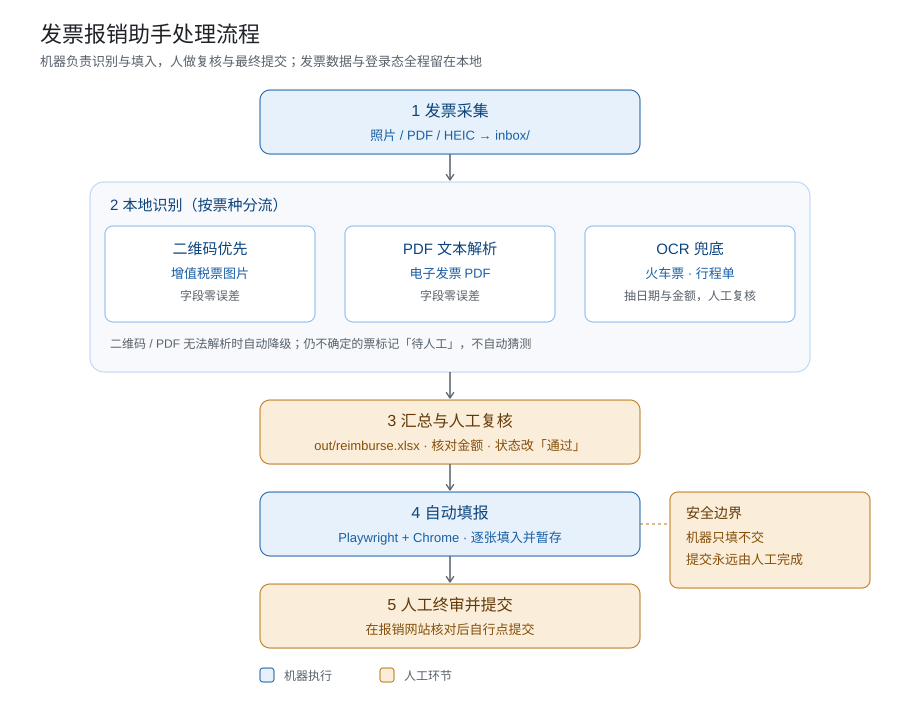

# 发票报销助手（WorkBuddy Skill）

把发票照片或 PDF 丢进一个文件夹，助手自动识别成 Excel 表格；核对一遍后，让助手把发票信息逐张填进学校报销网站，自己只需要在最后点提交。

## 处理流程



## 安装（只需一次）

1. 下载 [invoice-reimburse.zip](https://github.com/xincxiong/invoice-reimburse-skill/releases/latest/download/invoice-reimburse.zip)（最新版；本页右侧 Releases 和仓库 `dist/` 目录里也有同一个文件）
2. 双击解压，得到 `invoice-reimburse` 文件夹
3. 打开“终端”，粘贴下面这行并回车：

```bash
mkdir -p ~/.workbuddy/skills && mv ~/Downloads/invoice-reimburse ~/.workbuddy/skills/
```

4. 重启 WorkBuddy

如果不想敲命令，也可以在 WorkBuddy 里把 zip 直接拖进对话，说“帮我安装这个 skill”。

## 使用

**首次**：在 WorkBuddy 里说“初始化发票报销”。助手会建好工作目录并安装依赖，需要联网，约 1-2 分钟。如果电脑提示安装“命令行开发者工具”，按提示装完再说一次。

**日常**：

| 想做的事 | 在 WorkBuddy 里说 |
|---------|------------------|
| 识别发票 | 把发票图片/PDF 发给助手，或放进 `~/invoice-reimburse/inbox/`，说“处理发票” |
| 核对 | 打开 `~/invoice-reimburse/out/reimburse.xlsx`，核对金额，把“复核状态”改成“通过” |
| 填报 | 说“把发票填到报销网站”，在弹出的 Chrome 里登录，之后助手逐张填入并暂存 |
| 提交 | 自己在报销网站上检查后点提交（助手不会替你提交） |

**首次填报前**：告诉 WorkBuddy“帮我校准报销网站填报”，按提示打开发票录入页、把输入框信息发给它，配置一次即可长期用。

## 首次使用需要确认的事项

已确认的两项不用再管：电脑是 Mac、报销网站能用 Chrome 打开。下面这些需要你花几分钟看一眼，然后告诉 WorkBuddy。

| 需要确认 | 为什么 | 怎么确认并告诉它 |
|---------|-------|-----------------|
| 报销系统名称、发票录入页 URL | 决定填报时打开哪个页面 | 登录后复制地址栏，发给 WorkBuddy：“录入页是这个地址” |
| 系统里有没有“批量导入 / Excel 模板导入” | 有的话直接生成导入文件，自动填报可以省掉 | 在菜单里找一下，说“有批量导入”或“没有” |
| 录入页各输入框 | 决定每个字段填到哪里 | 右键输入框 → 检查，把高亮的 HTML 或页面截图发给它 |
| 登录方式 | 账号密码、校园统一认证、短信验证码的处理不同 | 直接说明；填报时按提示在 Chrome 里登录，再回终端按回车 |
| 网站必填字段有哪些 | 校验码、税额、购销方等，多的要删、少的要补 | 发一张录入页截图，说“按这个页面调整字段” |
| 月均张数、主要是哪类票 | 决定要不要装 OCR、要不要挂后台自动监控 | 说“每月大概 N 张，主要是电子发票 / 火车票” |
| 2-3 张真实发票 | 校准二维码类型码映射与字段抽取 | 放进 `inbox/`，说“用这几张真实发票校准识别”，再把票面金额念给它核对 |
| 是否需要发票真伪核验 | 税务查验平台有验证码，默认不做 | 学校要求就说“需要核验”，助手会安排人工核验环节 |

## 怎样让 WorkBuddy 调整 skill

所有调整都在对话里完成：把信息、截图或文件直接发进 WorkBuddy，说清想要什么，助手会修改 skill 的配置或脚本。不需要自己打开终端改代码。改完让它先用 1-2 张票试跑，确认无误再批量；提交动作始终由人工完成。

| 场景 | 在 WorkBuddy 里说 | 助手会做什么 |
|------|------------------|-------------|
| 首次校准网站 | “帮我校准报销网站填报”，并附上录入页 URL 和输入框 HTML | 改 `selectors.yaml` 的页面地址与各字段选择器 |
| 网站改版、某张填不进去 | “这张填不上，截图给你”，并附上 `out/error_N.png` 或录入页截图 | 定位失效的选择器并修正 |
| 字段增减 | “网站没有校验码这一栏”或“还要填经办人” | 增删字段映射，必要时同步调整 Excel 列 |
| 发现批量导入入口 | “网站支持 Excel 导入，模板发你” | 按模板生成导入文件，停用自动填报 |
| 火车票、出租车票变多 | “这类票比较多” | 安装 paddleocr，调整 OCR 兜底规则 |
| 想换存放位置 | “发票放在桌面那个文件夹” | 改 `config.yaml` 里的路径 |
| 想要自动识别 | “我丢发票就自动识别” | 启动 `watch.py` 后台监控 |
| 配置改乱了 | “恢复默认网站配置” | 从 `scripts/selectors.yaml` 复制一份模板重新校准 |
| 升级 skill | “升级发票报销助手” | 下载新版 zip 覆盖并跑 `setup.sh`，保留已校准配置与登录态 |

## 前提

- Mac 电脑，装有 Chrome 和 python3
- 报销网站能用 Chrome 打开
- 首次初始化需要联网

## 说明

- 识别在本地完成，发票图片不上传任何服务
- 二维码增值税发票和电子发票 PDF 是零误差解析；火车票、出租车票等需要可选 OCR 组件
- 复核状态、报销网站配置、Chrome 登录态在升级 skill 时不会丢失
- 仓库里 `scripts/` 是全部代码，`references/calibration.md` 是网站选择器校准说明

## 更新

当前版本 v1.0.1（2026-11-11）：skill 本体增加首次使用待确认项与对话式调整指引，助手会主动引导确认并代改配置。旧版用户重新下载即可。

重新下载新版 zip 覆盖 `~/.workbuddy/skills/invoice-reimburse/`，回到 `~/invoice-reimburse/` 目录再跑一次 `bash ~/.workbuddy/skills/invoice-reimburse/scripts/setup.sh` 即可；已核对过的数据和网站配置都会保留。
